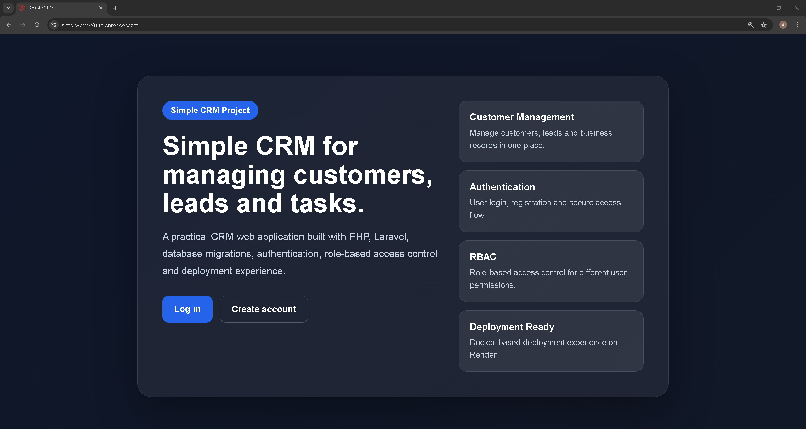
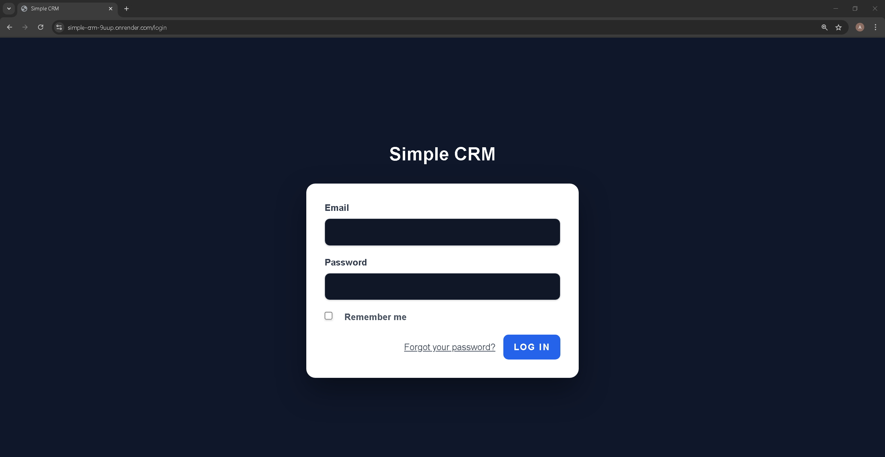
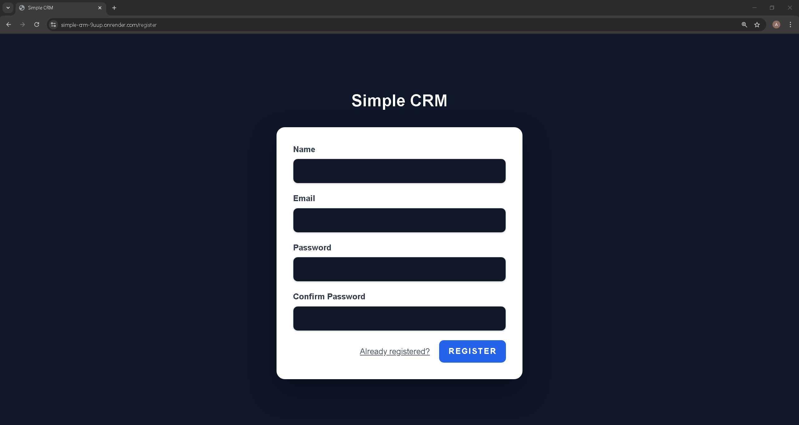
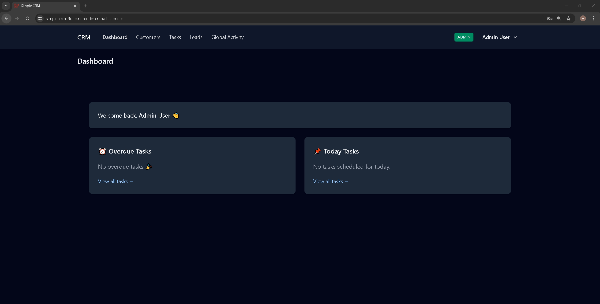
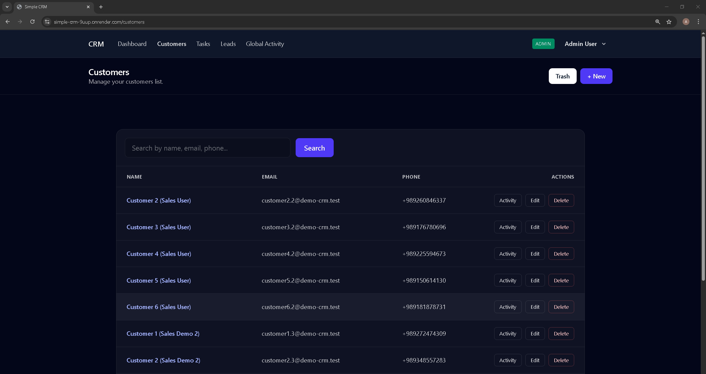
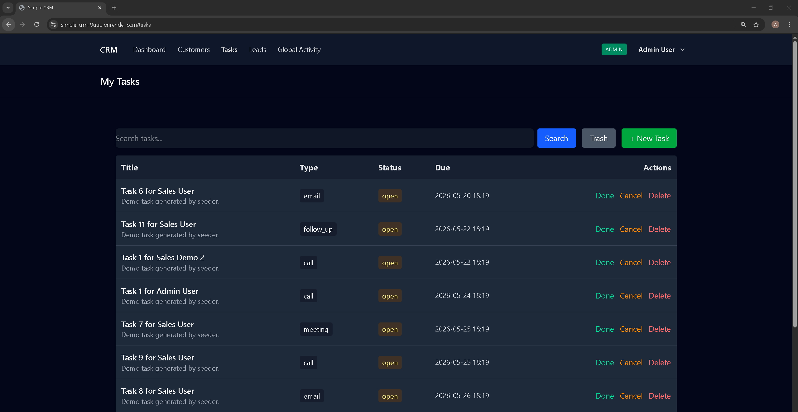
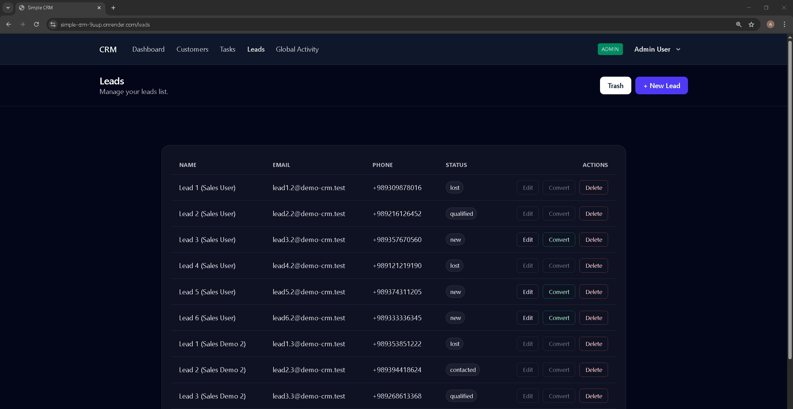
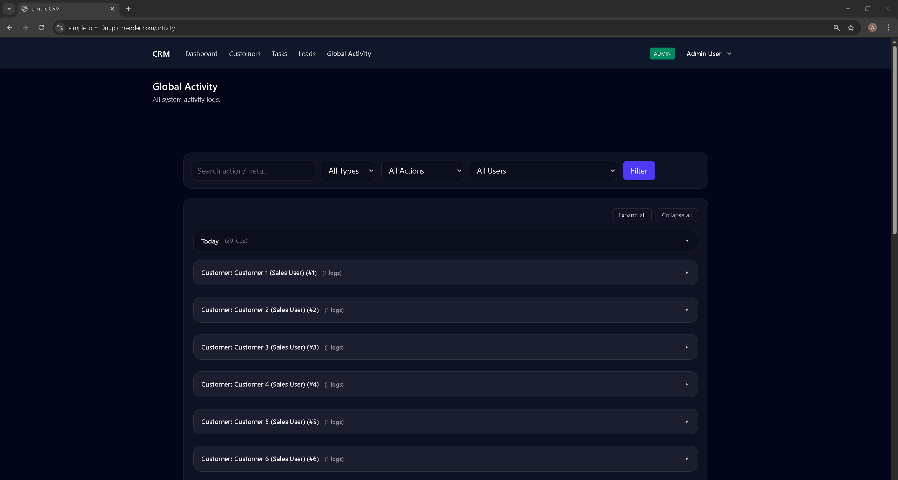

# Simple CRM — Laravel CRM Portfolio Project

A practical CRM web application built with **Laravel** for managing customers, leads, tasks, user roles, permissions, ownership rules, and activity logs.

This project demonstrates real-world backend concepts such as **authentication**, **role-based access control (RBAC)**, **resource ownership**, **CRUD operations**, **soft deletes**, **activity tracking**, seeded demo data, automated tests, and Docker-based deployment.

---

## Live Demo

Live URL:

https://simple-crm-9uup.onrender.com

> Note: This project is deployed on Render Free Plan. The first request may take some time because free instances can spin down after inactivity.

---

## Demo Accounts

You can test the application with these seeded demo accounts:

### Admin Account

```text
Email: admin@example.com
Password: Admin@123456
Role: Admin
```

### Sales Account

```text
Email: sales@example.com
Password: Sales@123456
Role: Sales
```

Admin users can access all records, while sales users have limited access based on ownership and permissions.

---

## Screenshots

### Landing Page



### Login Page



### Register Page



### Dashboard



### Customers



### Tasks



### Leads



### Global Activity



---

## Features

- User authentication
- Login and registration pages
- Admin dashboard
- Role-based access control
- Permission-based access
- Customer management
- Lead management
- Lead conversion to customer
- Task management
- Task status updates
- Soft deletes
- Trash and restore functionality
- Global activity log
- Ownership-based access rules
- Search and filtering
- Seeded demo users and demo data
- Automated feature tests
- Docker-based deployment
- Render deployment

---

## Tech Stack

- PHP 8.3
- Laravel 12
- Laravel Breeze
- Spatie Laravel Permission
- SQLite for demo deployment
- MySQL/PostgreSQL compatible structure
- Vite
- Tailwind CSS
- Docker
- Apache
- Render
- Git / GitHub

---

## Main Modules

### Customers

The Customers module allows users to manage customer records, including customer name, email, phone number, notes, ownership, edit actions, delete actions, trash, restore, and activity tracking.

### Leads

The Leads module allows users to manage potential customers, track lead status, record lead source, and convert leads into customers.

### Tasks

The Tasks module allows users to create and manage CRM-related tasks. Tasks can be attached to customers or leads and assigned to users. Tasks also support status updates and soft delete functionality.

### Global Activity

The Global Activity page tracks important system actions such as creating, updating, deleting, restoring, and converting CRM records.

### RBAC and Ownership

The project uses role-based access control to separate access between admin and sales users.

- Admin users can access all records.
- Sales users can only access records assigned to them.
- Permissions are managed using Spatie Laravel Permission.

---

## Seeded Users

The project includes demo users created by the database seeder:

```text
Admin:
admin@example.com
Admin@123456

Sales:
sales@example.com
Sales@123456
```

Additional seeded sales demo users may also be created for testing ownership-based access.

---

## Local Installation

Clone the repository:

```bash
git clone https://github.com/izadyar-amirreza/simple-crm.git
cd simple-crm
```

Install PHP dependencies:

```bash
composer install
```

Install frontend dependencies:

```bash
npm install
npm run build
```

Create environment file:

```bash
cp .env.example .env
```

Generate application key:

```bash
php artisan key:generate
```

Run migrations and seeders:

```bash
php artisan migrate --seed
```

Start the local development server:

```bash
php artisan serve
```

Then open:

```text
http://127.0.0.1:8000
```

---

## Testing

This project includes feature tests for authentication, profile functionality, customer authorization, RBAC, and ownership rules.

Run tests with:

```bash
php artisan test
```

---

## Docker Deployment

This project includes a Dockerfile and can be deployed as a Docker-based Laravel application.

The Render deployment uses:

- Apache
- PHP 8.3
- Composer
- Node.js / npm
- Laravel migrations
- Laravel seeders
- SQLite demo database

---

## Render Deployment Notes

For the Render deployment, the following environment variables are used:

```env
APP_NAME=Simple CRM
APP_ENV=production
APP_DEBUG=false
APP_URL=https://simple-crm-9uup.onrender.com

DB_CONNECTION=sqlite
DB_DATABASE=/var/www/html/database/database.sqlite

SESSION_DRIVER=file
SESSION_SECURE_COOKIE=true
CACHE_STORE=file
QUEUE_CONNECTION=sync
LOG_CHANNEL=stderr
LOG_LEVEL=debug
```

Important note:

This demo currently uses SQLite on Render. On a free deployment, data may reset after redeploys or service restarts. For a production-ready version, PostgreSQL or MySQL should be used.

---

## Project Purpose

This project was built as a portfolio CRM application to demonstrate practical Laravel development skills, including:

- Backend development
- Database migrations
- Authentication
- Authorization
- RBAC
- Ownership-based access control
- CRUD operations
- Soft deletes
- Activity logging
- Docker deployment
- Debugging production deployment issues
- Working with real deployment environments

---

## Author

Amirreza Izadyar

GitHub:

https://github.com/izadyar-amirreza